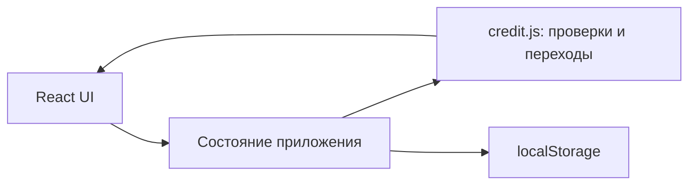
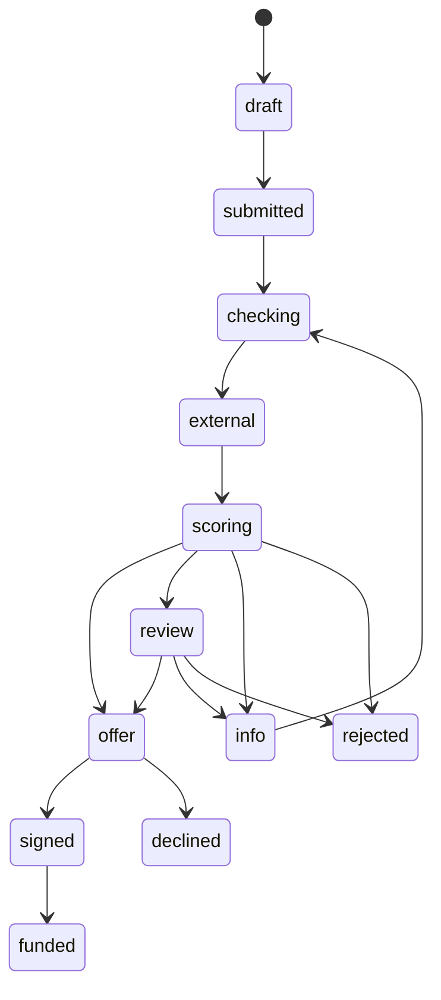

# Умный кредитный кабинет предпринимателя

Прототип цифрового кредитного конвейера для малого бизнеса (кейс Альфа Хак). Репозиторий
состоит из двух частей: платформы (бэкенд, скоринг, моки внешних систем, инфраструктура) и
фронтенд-прототипа кабинета на React. Пока они работают независимо: фронтенд использует
демо-данные в браузере, а весь путь через API проходится в Swagger и Bruno.

Клиентский путь и обработка заявки банком объединены в один процесс: подбор продукта → заявка →
автоматическая проверка и скоринг → оффер → подписание → выдача, с ручной проверкой андеррайтером
и дозапросом документов внутри той же заявки.

Что важно для клиента и как это реализовано:

- **Статус, срок и следующий шаг видны всегда**, изменения приходят в кабинет сразу (SSE).
- **Банк не спрашивает то, что знает:** в заявке только параметры кредита, данные компании
  берутся из профиля и источников.
- **Договор = оффер:** условия копируются без изменений и сверяются перед подписью.
- **Кредит не зависит от других продуктов банка** — ни в решении, ни в условиях.
- **Решение всегда с причинами** простым языком.

## Состав репозитория

| Каталог | Что внутри |
|---|---|
| [`backend/`](backend) | FastAPI: API кабинета и андеррайтера, worker и планировщик на Taskiq |
| [`ml/`](ml) | PD-модель (LightGBM) и кредитная политика, `POST /v1/decision` ([README](ml/README.md)) |
| [`mocks/`](mocks) | моки ЕГРЮЛ/ЕГРИП, ФНС, БКИ и АБС с режимом отказов |
| [`seed/`](seed) | синтетические компании: профиль для бэкенда и ответы источников для моков |
| [`infra/keycloak/`](infra/keycloak) | realm `alfa-credit`: клиент, роли, тестовые пользователи |
| [`collection/`](collection) | коллекция запросов Bruno |
| [`docs/`](docs) | процесс, архитектура, API, OpenAPI, тест-сценарии, исследование |
| [`frontend/`](frontend) | прототип интерфейса кабинета: React + Vite, демо-данные в `localStorage` (раздел «Фронтенд») |

## Платформа: быстрый старт

Нужны Docker с Compose v2 и `make`. Для тестов дополнительно нужен [uv](https://docs.astral.sh/uv/).

```bash
make up_build          # сборка и запуск; .env создаётся из .env.test, если его нет
curl localhost:8000/ready
```

Первый запуск занимает несколько минут: собираются образы, Keycloak импортирует realm,
`credit-migrate` применяет миграции и загружает seed. Когда `/ready` отвечает `"status": "ready"`,
всё готово.

| Что | Адрес | Вход |
|---|---|---|
| Swagger кабинета | http://localhost:8000/docs | Authorize → учётка из таблицы ниже |
| Keycloak | http://localhost:8080 | админка: `admin` / `admin` |
| Скоринг (Swagger) | http://localhost:8001/docs | — |
| Моки (Swagger) | http://localhost:8002/docs | — |
| MinIO | http://localhost:9001 | `minioadmin` / `minioadmin` |

Начать с чистого листа: `make down_v && make up_build` (удаляет данные Postgres, Keycloak, Redis
и MinIO).

## Тестовые учётки

Пароль у всех — `alfa2026`.

| Логин | Роль | Компания | Сценарий |
|---|---|---|---|
| `ip.ivanov` | клиент, может подписывать | ИП Иванов | одобрение → выдача |
| `ooo.romashka.director` | клиент, может подписывать | ООО «Ромашка» | встречное предложение |
| `ooo.romashka.accountant` | клиент, без права подписи | ООО «Ромашка» | готовит заявку, подписать не может |
| `ooo.vector.director` | клиент, может подписывать | ООО «Вектор» | налоговый долг → справка → одобрение |
| `ip.petrov` | клиент, может подписывать | ИП Петров | массовый адрес → андеррайтер |
| `ooo.delta.director` | клиент, может подписывать | ООО «Дельта» | просрочка 90+ → отказ → новая заявка |
| `underwriter` | андеррайтер | — | очередь и карточка ручной проверки |

Суммы и сроки, на которых профиль даёт заявленный исход, лежат в `demo_request` каждой компании
в [`seed/companies.json`](seed/companies.json).

## Проверка за пять минут

1. Swagger → Authorize → `ip.ivanov`.
2. `POST /api/v1/applications`:
   `{"product":"express","requested_amount":1500000,"term_months":12,"purpose":"working_capital"}`.
3. `POST /api/v1/applications/{id}/submit` с `{"consent_bki":true,"consent_pd":true}`.
4. Через несколько секунд `GET /api/v1/applications/{id}` — статус OFFERED, оффер и причины.
5. `POST …/offer/accept` → `POST …/contract/sign-code` → `POST …/contract/sign` с кодом из ответа.
6. `GET /api/v1/applications/{id}` — ISSUED «Деньги на счёте», в `events` весь журнал.
7. Войти как `underwriter`: `GET /api/v1/underwriter/applications/{id}` — PD, грейд, факторы,
   снимки источников, версии модели и политики.

То же самое одной кнопкой: папка `00 Основной путь` в Bruno (окружение `local`) или
`make test_e2e` для всех сценариев. Подробные шаги и ожидаемые результаты —
[docs/test-scenarios.md](docs/test-scenarios.md).

## Команды

| Команда | Что делает |
|---|---|
| `make up` / `make up_build` | запуск / сборка и запуск всех сервисов |
| `make stop`, `make down`, `make down_v` | остановка / удаление контейнеров / вместе с данными |
| `make logs`, `make logs_all` | логи backend / всех сервисов |
| `make migrate` | применить миграции и seed |
| `make lint` | ruff и mypy |
| `make test` | юнит- и интеграционные тесты (testcontainers, нужен Docker) |
| `make test_contract` | контрактные тесты против запущенного ml |
| `make test_e2e` | сквозные сценарии против поднятого стенда |
| `make openapi` | выгрузить `docs/openapi.json` |

## Переменные окружения

Все настройки backend задаются через `.env` (шаблон — [`.env.test`](.env.test)), вложенные
секции разделяются `__`.

| Переменная | Значение в compose | Назначение |
|---|---|---|
| `APP__ENVIRONMENT` | `dev` | `local`, `unittest` и `integration_test` включают заглушку авторизации |
| `APP__AUTH_ENABLED` | `true` | выключать можно только в локальных окружениях |
| `POSTGRES__HOST`, `__PORT`, `__DB`, `__USER`, `__PASSWORD` | `credit-postgres`, `5432`, `credit_cabinet`, `admin`, `credit_cabinet` | база кабинета |
| `SQL_ENGINE__POOL_SIZE`, `__MAX_OVERFLOW` | `5`, `10` | пул соединений |
| `AUTH__KEYCLOAK__BASE_URL` | `http://credit-keycloak:8080` | адрес Keycloak внутри Docker (JWKS, userinfo) |
| `AUTH__KEYCLOAK__PUBLIC_URL` | `http://localhost:8080` | адрес Keycloak для браузера и Swagger |
| `AUTH__KEYCLOAK__REALM`, `__CLIENT_ID` | `alfa-credit`, `credit-cabinet-web` | realm и клиент |
| `AUTH__JWT__ISSUER` | `http://localhost:8080/realms/alfa-credit` | ожидаемый `iss` |
| `AUTH__JWT__AUDIENCE` | `["credit-backend"]` | ожидаемый `aud` |
| `AUTH__JWT__VERIFY_AUTHORIZED_PARTY` | `true` | проверять `azp = CLIENT_ID` |
| `REDIS__HOST`, `__PORT` | `credit-redis`, `6379` | брокер задач |
| `SCORING__URL` | `http://credit-ml:8000` | сервис скоринга |
| `MOCKS__URL` | `http://credit-mocks:8000` | моки внешних систем |
| `S3__ENDPOINT_URL`, `__ACCESS_KEY`, `__SECRET_KEY`, `__BUCKET` | `http://credit-minio:9000`, `minioadmin`, `minioadmin`, `credit-documents` | хранилище документов |
| `SEED__PATH` | `/seed/companies.json` | файл seed для `credit-migrate` |

Ключевая ставка задаётся только в ml (`KEY_RATE` в `compose.yml`), бэкенд читает её из
`GET /v1/model`.

## Фронтенд

Первый фронтенд-прототип кейса. React + JavaScript + Vite, адаптивный интерфейс на русском языке.
Все компании, финансовые показатели, проверки и решения синтетические.

### Запуск

Нужен Node.js **22.12+** (рекомендуется Node 22, версия указана в `frontend/.nvmrc`).

```bash
cd frontend
npm ci
npm run dev
```

Открыть адрес из вывода Vite, обычно http://localhost:5173.

```bash
npm test          # проверки кредитного процесса и расчёта платежей
npm run build    # production-сборка в dist/
npm run preview  # просмотр сборки
npm run format   # форматирование исходников
```

Запуск через Docker из корня репозитория (файл `compose.yaml`, только фронтенд):

```bash
docker compose -f compose.yaml up --build
```

Интерфейс будет доступен по адресу http://localhost:8080. Сборке Docker нужен интернет для скачивания базовых образов и npm-зависимостей; после сборки приложение работает без внешних сервисов, шрифты поставляются локально.

Контейнер использует nginx-unprivileged и работает от пользователя `101:101`, без root. Внутренний порт — `8080`; при деплое внешний порт `APP_PORT` нужно направлять на `8080` контейнера. В GitLab CI сборка выполняется из `./frontend`.

Фронтенд и платформа пока запускаются разными compose-файлами (`compose.yaml` и `compose.yml`) и
оба публикуют порт `8080` на хосте: фронтенд — интерфейс, платформа — Keycloak. Одновременно их
не поднять, пока у одного из них не сменён порт. Команда `docker compose` без `-f` берёт
`compose.yaml`; все цели Makefile работают с `compose.yml`.

### Что готово

- Дашборд с иллюстративным индексом кредитного здоровья, обязательствами и активными заявками.
- Каталог четырёх продуктов с демонстрационными условиями.
- Мастер заявки: цель → условия → компания → финансы и документы → контакты → подтверждение.
- Валидация полей, предварительный аннуитетный платёж, автоматическое сохранение черновика.
- Mock-загрузка документов: сохраняются только имя и размер файла, содержимое не читается и не отправляется.
- Проверки ЕГРЮЛ/ФНС/БКИ, скоринговый балл, история переходов и in-app уведомления.
- Одобрение, изменённая сумма, запрос сведений, ручное рассмотрение, отказ.
- Предложение с предварительным графиком платежей, принятие/отклонение, подпись демо-кодом **1234**, имитация выдачи.
- Редактирование компании и контактного лица.
- Рабочее место банка с поиском, фильтром статусов, карточкой заявки и решениями менеджера.
- Две карточки полезных материалов; первая меняется при появлении одобренной заявки. Это пока условная персонализация, а не полноценная новостная лента.

### Сценарий проверки

1. При первом открытии доступны демо-компания и одна одобренная заявка. Её можно открыть и сразу проверить подписание/выдачу.
2. Нажать «Новая заявка», пройти шесть шагов с синтетическими данными. На любом шаге можно уйти и продолжить из «Мои заявки». Черновик сохраняется при каждом изменении.
3. Отправить заявку. Выбрать демонстрационный сценарий и нажать «Запустить демо-проверки».
4. Для автоматического одобрения оставить предзаполненные финансовые показатели. Сценарий «Одобрение с изменением суммы» предложит 80% запрошенной суммы.
5. Проверить график, нажать «Принять и подписать», ввести **1234**. Нажать «Смоделировать выдачу» и увидеть статус «Средства предоставлены».
6. Для ручного сценария создать ещё одну заявку, выбрать «Ручное рассмотрение» и запустить проверки. Переключиться в «Рабочее место банка», открыть заявку, написать обоснование и принять решение.
7. Для запроса сведений выбрать соответствующий сценарий, добавить любой тестовый PDF/JPG/PNG до 10 МБ и передать документы банку. После этого заявка ожидает решения менеджера.
8. Проверить уведомления через колокольчик, поиск/фильтры заявок, профиль и сохранение данных после перезагрузки.

Данные хранятся только в `localStorage` этого браузера (ключ `alfa-credit-demo-v1`). Для полного сброса удалить этот ключ в инструментах разработчика. У разных браузеров/устройств данные независимы; вкладки не синхронизируются в реальном времени.

### Структура и архитектура

```text
frontend/
  src/
    App.jsx                       оболочка, навигация и состояние
    components/
      Dashboard.jsx               обзор и карточки продуктов
      Wizard.jsx                  мастер и mock-загрузка документов
      ApplicationDetails.jsx      проверки, решения, оферта и история
      UI.jsx                      общие компоненты
    lib/
      credit.js                   данные продуктов, расчёты и переходы
      credit.test.js              проверки бизнес-сценариев
    styles.css                    стили и адаптивные раскладки
  Dockerfile                      сборка Vite и раздача через nginx
```



Скоринг: `870 - сумма / месячная_выручка × 25 - месячные_кредитные_платежи / месячная_выручка × 130`, ограниченный диапазоном 100–950. В автоматическом сценарии балл ниже 450 ведёт к отказу, 450–649 — к ручному рассмотрению, от 650 — к предложению. Явно выбранный демо-сценарий переопределяет результат, но не рассчитанный балл. Рейтинг **812** на дашборде — отдельный фиксированный пример индекса бизнеса, не скоринг заявки.



Переходы проверяются функцией `transition`; недопустимый переход вызывает ошибку. В истории сохраняются статус, время, автор и комментарий. Данные заявки включают снимок компании, параметры кредита, финансовые показатели, метаданные документов, результаты проверок, сумму предложения и историю.

### Ограничения и дальнейшая работа

Это **фронтенд-прототип**, не готовая банковская система. Вход в демо-компанию выполняется автоматически, переключатель кабинетов не является авторизацией или разграничением доступа. Не вводите реальные персональные данные или банковские документы.

Фронтенд пока не подключён к API платформы: REST API, вход через Keycloak, роли, база данных, хранение файлов в MinIO, журнал событий, OpenAPI и интеграционные контракты уже есть на стороне бэкенда ([docs/api.md](docs/api.md)), но интерфейс их не вызывает. Следующий этап — заменить локальные операции вызовами API, перейти на вход через Keycloak (Authorization Code + PKCE) и получать статус заявки из SSE-потока. После подключения итоговый кредитный статус и права доступа определяет сервер.

`compose.yaml` на этом этапе запускает только фронтенд.

### Обновление клиентского пути по feature/credit-scoring-model

Использованы `docs/process.md` (статусы и правила процесса), `docs/research.md` (CJM) и контракт `ml/src/credit_scoring/decision.py` из локальной remote-tracking ветки `origin/feature/credit-scoring-model`.

Текущий интерфейс заменяет прежний мастер из шести шагов: клиент выбирает цель, сумму, срок, заявленную стоимость залога и подтверждает согласия. Продукты согласованы с моделью: оборотное финансирование, инвестиционный кредит, овердрафт. Данные компании и финансовые показатели берутся из демо-профиля. Старые заявки на кредитную линию при чтении локального хранилища переводятся на оборотный продукт.

У статуса показываются ориентир по времени и следующий шаг; в карточке заявки блок закреплён при прокрутке. Клиенту не показываются скоринговые баллы, PD и грейд. Карточка банка показывает их при наличии в данных. Ответы модели поддерживают причины в `text` или `label`, факторы в `label`, оффер с `rate`, `term_months`, `amount`, `monthly_payment`. Реальный HTTP-вызов ML-сервиса ещё не подключён; локальная демо-логика не заменяет исследовательскую модель, PD и грейд не выдумываются.

Менеджер может изменить сумму, срок и ставку с обязательным комментарием. Клиент видит отличие от запроса. Принятие оффера сохраняет условия, затем руководитель подписывает договор кодом 1234. Для демо сменить роль на «Генеральный директор» можно в профиле и вернуться в ту же заявку. Это UI-симуляция роли, серверная проверка полномочий ещё необходима. Новые предложения действуют 14 дней, просроченное принять нельзя.

Дозапрос содержит полный список документов с отдельной загрузкой для каждого пункта в ту же заявку. Передача доступна только после заполнения всего списка. Загрузка по-прежнему сохраняет только метаданные. Отказ содержит причины и рекомендации, выдача — подтверждение демо-зачисления.

## Документация

- [Модель процесса](docs/process.md): этапы, статусы, модель данных, источники признаков, допущения.
- [Архитектура](docs/architecture.md): сервисы, слои кода, потоки, надёжность, безопасность.
- [API](docs/api.md) и [OpenAPI](docs/openapi.json).
- [Тест-сценарии](docs/test-scenarios.md).
- [Исследование клиентов](docs/research.md).
- [Скоринговая модель](ml/README.md).
- Сторонние компоненты: [платформа](THIRD_PARTY_NOTICES.md), [фронтенд](THIRD_PARTY_NOTICES).

## Ограничения прототипа

- Все данные синтетические, внешние системы заменены моками.
- Подпись моделируется кодом, который показывается в интерфейсе; выдача — записью в моке АБС.
- Учётные данные в `.env.test`, realm и compose — демонстрационные; для реального развёртывания их
  нужно заменить и вынести в секреты.
- Фронтенд работает на демо-данных в браузере и к API платформы пока не подключён.
