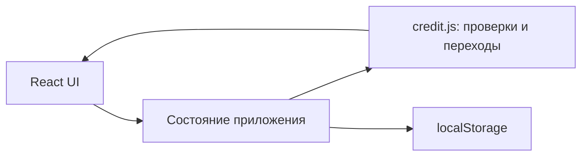
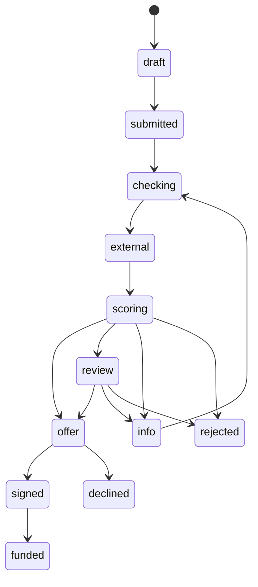

# Умный кредитный кабинет предпринимателя

Первый фронтенд-прототип кейса Альфа-Хак. React + JavaScript + Vite, адаптивный интерфейс на русском языке. Все компании, финансовые показатели, проверки и решения синтетические.

## Запуск

Нужен Node.js **22.12+** (рекомендуется Node 22, версия указана в `frontend/.nvmrc`).

```bash
cd frontend
npm ci
npm run dev
```

Открыть адрес из вывода Vite, обычно http://localhost:5173.

```bash
npm test          # проверки кредитного процесса и расчёта платежей
npm run build    # production-сборка в dist/
npm run preview  # просмотр сборки
npm run format   # форматирование исходников
```

Запуск через Docker из корня репозитория:

```bash
docker compose up --build
```

Интерфейс будет доступен по адресу http://localhost:8080. Сборке Docker нужен интернет для скачивания базовых образов и npm-зависимостей; после сборки приложение работает без внешних сервисов, шрифты поставляются локально.

## Что готово

- Дашборд с иллюстративным индексом кредитного здоровья, обязательствами и активными заявками.
- Каталог четырёх продуктов с демонстрационными условиями.
- Мастер заявки: цель → условия → компания → финансы и документы → контакты → подтверждение.
- Валидация полей, предварительный аннуитетный платёж, автоматическое сохранение черновика.
- Mock-загрузка документов: сохраняются только имя и размер файла, содержимое не читается и не отправляется.
- Проверки ЕГРЮЛ/ФНС/БКИ, скоринговый балл, история переходов и in-app уведомления.
- Одобрение, изменённая сумма, запрос сведений, ручное рассмотрение, отказ.
- Предложение с предварительным графиком платежей, принятие/отклонение, подпись демо-кодом **1234**, имитация выдачи.
- Редактирование компании и контактного лица.
- Рабочее место банка с поиском, фильтром статусов, карточкой заявки и решениями менеджера.
- Две карточки полезных материалов; первая меняется при появлении одобренной заявки. Это пока условная персонализация, а не полноценная новостная лента.

## Сценарий проверки

1. При первом открытии доступны демо-компания и одна одобренная заявка. Её можно открыть и сразу проверить подписание/выдачу.
2. Нажать «Новая заявка», пройти шесть шагов с синтетическими данными. На любом шаге можно уйти и продолжить из «Мои заявки». Черновик сохраняется при каждом изменении.
3. Отправить заявку. Выбрать демонстрационный сценарий и нажать «Запустить демо-проверки».
4. Для автоматического одобрения оставить предзаполненные финансовые показатели. Сценарий «Одобрение с изменением суммы» предложит 80% запрошенной суммы.
5. Проверить график, нажать «Принять и подписать», ввести **1234**. Нажать «Смоделировать выдачу» и увидеть статус «Средства предоставлены».
6. Для ручного сценария создать ещё одну заявку, выбрать «Ручное рассмотрение» и запустить проверки. Переключиться в «Рабочее место банка», открыть заявку, написать обоснование и принять решение.
7. Для запроса сведений выбрать соответствующий сценарий, добавить любой тестовый PDF/JPG/PNG до 10 МБ и передать документы банку. После этого заявка ожидает решения менеджера.
8. Проверить уведомления через колокольчик, поиск/фильтры заявок, профиль и сохранение данных после перезагрузки.

Данные хранятся только в `localStorage` этого браузера (ключ `alfa-credit-demo-v1`). Для полного сброса удалить этот ключ в инструментах разработчика. У разных браузеров/устройств данные независимы; вкладки не синхронизируются в реальном времени.

## Структура и архитектура

```text
frontend/
  src/
    App.jsx                       оболочка, навигация и состояние
    components/
      Dashboard.jsx               обзор и карточки продуктов
      Wizard.jsx                  мастер и mock-загрузка документов
      ApplicationDetails.jsx      проверки, решения, оферта и история
      UI.jsx                      общие компоненты
    lib/
      credit.js                   данные продуктов, расчёты и переходы
      credit.test.js              проверки бизнес-сценариев
    styles.css                    стили и адаптивные раскладки
  Dockerfile                      сборка Vite и раздача через nginx
backend/                          место для будущего сервиса
```



Скоринг: `870 - сумма / месячная_выручка × 25 - месячные_кредитные_платежи / месячная_выручка × 130`, ограниченный диапазоном 100–950. В автоматическом сценарии балл ниже 450 ведёт к отказу, 450–649 — к ручному рассмотрению, от 650 — к предложению. Явно выбранный демо-сценарий переопределяет результат, но не рассчитанный балл. Рейтинг **812** на дашборде — отдельный фиксированный пример индекса бизнеса, не скоринг заявки.



Переходы проверяются функцией `transition`; недопустимый переход вызывает ошибку. В истории сохраняются статус, время, автор и комментарий. Данные заявки включают снимок компании, параметры кредита, финансовые показатели, метаданные документов, результаты проверок, сумму предложения и историю.

## Ограничения первого этапа и дальнейшая работа

Это **фронтенд-прототип**, не готовая банковская система. Вход в демо-компанию выполняется автоматически, переключатель кабинетов не является авторизацией или разграничением доступа. Не вводите реальные персональные данные или банковские документы.

REST API, серверная аутентификация, роли, база данных, реальное хранение файлов, серверный аудит, OpenAPI и интеграционные контракты ещё не реализованы. Следующий этап — перенести обработку и хранение на backend, заменить локальные операции вызовами API и добавить полноценный вход/регистрацию и онбординг. При подключении backend итоговый кредитный статус и права доступа должны определяться сервером.

Docker-конфигурация на этом этапе запускает только frontend. Полный комплект платформенных материалов из задания будет расширяться вместе с backend.
