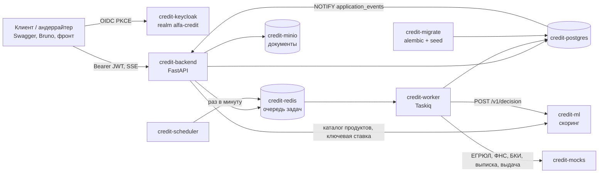

# Архитектура

Документ описывает, из каких сервисов состоит прототип, как они взаимодействуют и как в коде
устроен бэкенд. Процесс, статусы и модель данных описаны в [process.md](process.md), API — в
[api.md](api.md).

## 1. Сервисы



| Сервис | Образ | Порт на хосте | Назначение |
|---|---|---|---|
| `credit-postgres` | `postgres:18.6-bookworm` | 5432 | данные кабинета |
| `credit-keycloak` | `quay.io/keycloak/keycloak:26.8.1` | 8080 | SSO; realm импортируется из `infra/keycloak/realm-alfa-credit.json` |
| `credit-redis` | `redis:8.8.3-alpine` | 6379 | брокер Taskiq (Redis Streams с подтверждением) |
| `credit-minio` | `pgsty/minio:RELEASE.2026-08-04T00-00-00Z` | 9000, 9001 | файлы документов, S3 API |
| `credit-ml` | сборка `./ml` | 8001 | PD-модель и кредитная политика |
| `credit-mocks` | сборка `./mocks` | 8002 | ЕГРЮЛ/ЕГРИП, ФНС, БКИ, АБС по ИНН из `seed/companies.json` |
| `credit-migrate` | образ backend | — | `alembic upgrade head` и идемпотентный seed, затем завершается |
| `credit-backend` | образ backend | 8000 | API и SSE |
| `credit-worker` | образ backend | — | обработка заявок и выдача |
| `credit-scheduler` | образ backend | — | истечение сроков, перезапуск зависших заявок |

Backend, worker и scheduler — один образ с разными командами: логика пишется один раз, а
процессы масштабируются отдельно. Все порты опубликованы только на `127.0.0.1`.

Порядок запуска задают `depends_on`: backend, worker и scheduler ждут успешного завершения
`credit-migrate`, а тот ждёт healthcheck Postgres. Поэтому реплики не гоняются за схемой БД.

## 2. Слои бэкенда

```
backend/src/
  domain/          сущности и правила процесса, без зависимостей от фреймворков
  application/     use cases и интерфейсы (Protocol) для всего внешнего
  infra/           реализации интерфейсов: Postgres, HTTP-шлюзы, S3, Taskiq, LISTEN
  presentation/    HTTP API (FastAPI) и задачи worker'а
  core/            настройки и сборка зависимостей
  seed/            загрузка компаний и представителей
```

Зависимости направлены внутрь: `presentation → application → domain`, `infra` реализует
интерфейсы из `application`. Домен не импортирует SQLAlchemy: dataclass-сущности связываются с
таблицами через imperative mapping в `infra/postgres/mappings.py`.

| Что | Где |
|---|---|
| Статусы, переходы, тексты для клиента, сроки | `domain/statuses.py` |
| Исход скоринга → статус, грейды | `domain/outcomes.py` |
| Ставка и аннуитетный платёж (копия политики ml) | `domain/pricing.py` |
| Продукты и подбор по цели | `domain/products.py` |
| Заявка и её переходы | `domain/entities/loan_application.py` |
| Сборка запроса к ml по таблице process.md §6 | `application/decision_request.py` |
| Конвейер: обогащение → скоринг → решение | `application/use_cases/processing/process_application.py` |
| Выдача через АБС | `application/use_cases/processing/disburse.py` |
| Истечение сроков и перезапуск | `application/use_cases/processing/maintenance.py` |
| Решения андеррайтера | `application/use_cases/underwriter/decide.py` |
| Таблицы и миграции | `infra/postgres/models.py`, `infra/postgres/migrations/` |
| Unit of Work с `pg_notify` | `infra/postgres/uow.py` |
| Слушатель LISTEN для SSE | `infra/notify/listener.py` |
| Зеркало `ApplicationIn` из ml | `infra/http/scoring.py` |

DI сделан через `Depends` FastAPI (`core/dependencies/`), без контейнера. Объекты уровня
приложения (engine, HTTP-клиент, шлюзы, слушатель LISTEN) создаются в lifespan и лежат в
`app.state`. Worker поднимает такой же lifespan через `taskiq-fastapi`, поэтому задачи используют
те же use cases, что и API.

## 3. Ключевые потоки

### 3.1 От отправки до решения

1. `POST /applications/{id}/submit` фиксирует согласия, переводит DRAFT → SUBMITTED и **после
   commit** ставит задачу `process_application`.
2. Worker в первой транзакции переводит SUBMITTED → CHECKING и коммитит. Без блокировки строки
   параллельно запрашивает четыре источника и вызывает `POST /v1/decision`.
3. Во второй транзакции worker снова берёт заявку под `SELECT … FOR UPDATE`. Если статус уже не
   CHECKING, он ничего не делает. Иначе сохраняет DECISION целиком (запрос, ответ, версии модели и
   политики), четыре ENRICHMENT_SNAPSHOT, OFFER (если есть) и выполняет переход по таблице
   process.md §5.

### 3.2 Журнал и уведомления

Статус меняется только через `LoanApplication.transition_to`. Метод проверяет переход по
`TRANSITIONS` и записывает событие внутрь сущности. При commit UoW забирает события из всех
заявок сессии, сохраняет их и вызывает `pg_notify('application_events', …)` в той же
транзакции. NOTIFY доставляется только после commit, поэтому клиент не увидит статус, который
потом откатился. Правило «каждый переход в журнале» выполняется по построению.

### 3.3 Статус в реальном времени

В каждом процессе API одно соединение asyncpg держит `LISTEN application_events` и раздаёт
события подписчикам через очереди. Число соединений с БД не растёт с числом открытых вкладок.
`GET /applications/{id}/stream` (SSE) первым событием отдаёт текущий статус, затем каждое
изменение. Каждые 15 с уходит keepalive-комментарий. После переподключения клиент сразу получает
актуальный статус, поэтому повтор пропущенных событий не нужен.

### 3.4 Подписание и выдача

При принятии оффера создаётся CONTRACT: сумма, срок, ставка и платёж копируются из OFFER. Перед
подписью код сверяет договор с оффером (`ContractMismatch` → 409). Код подписи показывается в
интерфейсе и действует 5 минут; в БД хранится только его хэш. После подписи задача `disburse`
вызывает мок АБС с `Idempotency-Key = contract_id`; `DISBURSEMENT.contract_id` уникален, поэтому
двойного зачисления не будет.

## 4. Надёжность

| Риск | Мера |
|---|---|
| Задача потерялась (падение worker, Redis) | Redis Streams с подтверждением; планировщик раз в минуту переставляет задачи для заявок, которые дольше 5 минут в SUBMITTED, CHECKING или SIGNED |
| Источник или ml недоступен | HTTP-вызовы: таймаут 5 с, до 3 попыток на сетевые ошибки и 5xx. Обработка заявки: до 5 попыток с паузами 2, 4, 8, 16 с; клиент всё это время видит «на рассмотрении». Затем заявка уходит андеррайтеру с причиной `SYSTEM_UNAVAILABLE` и не зависает |
| Повторная доставка задачи, двойной клик | Все команды идемпотентны по состоянию: задача берёт заявку под `FOR UPDATE` и выходит, если статус уже другой; повторный `submit` возвращает текущее состояние |
| Гонка «клиент принимает оффер — планировщик его истекает» | Обе стороны блокируют строку заявки; переход выполняет одна, вторая получает 409 или ничего не делает |
| Дубли заявок | Частичный уникальный индекс: одна активная заявка на компанию и продукт |
| Сроки | Истёкший оффер → CANCELLED; INFO_REQUESTED без ответа 30 дней → CANCELLED |

Для демонстрации у моков есть режим отказов: `PUT /admin/failures/{egrul|fns|bki|abs|all}` с
`{"mode": "error" | "timeout" | "off"}`.

Состояние сервиса: `GET /health` (процесс жив) и `GET /ready` (Postgres, Redis, JWKS Keycloak,
ml). Логи пишутся в JSON с `request_id`; заголовок `X-Request-ID` принимается от клиента или
генерируется и возвращается в ответе.

## 5. Безопасность

- Вход через Keycloak по OIDC: Authorization Code + PKCE для браузера и Swagger, публичный клиент
  без секрета.
- Бэкенд проверяет подпись JWT по JWKS, `iss`, `aud = credit-backend` (audience-mapper в realm) и
  `azp = credit-cabinet-web`. Токен другого клиента того же realm не принимается.
- Роли realm `client` и `underwriter` проверяются на уровне роутеров.
- Клиент видит только заявки своей компании; на чужую заявку отвечаем 404, а не 403, чтобы не
  раскрывать её существование.
- Подписать договор может только представитель с `can_sign`; бухгалтер готовит заявку, но
  получает 403 «передайте руководителю».
- Клиенту не показываются PD и балл модели: только причины и факторы простым языком.
- Документы до 10 МБ, только PDF, JPG, PNG и CSV; файл отдаётся через бэкенд с той же проверкой
  доступа, что и заявка.

## 6. Технологии

Python 3.12, FastAPI 0.160, SQLAlchemy 2.1 (async) + asyncpg, Alembic, PostgreSQL 18, Keycloak
26.8 + PyJWT, Taskiq + Redis Streams, MinIO + aioboto3, httpx + tenacity, Jinja2 для HTML
договора, uv для зависимостей. Тесты: pytest, testcontainers (Postgres, MinIO), respx. Качество
кода: ruff и mypy. Все версии зафиксированы в `uv.lock` и тегах образов.
