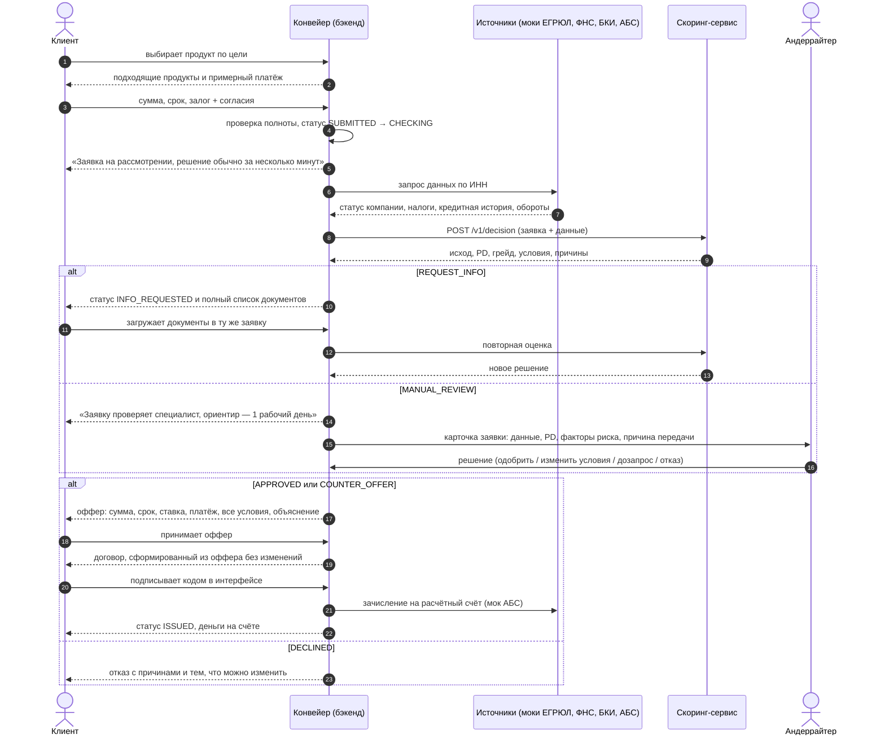
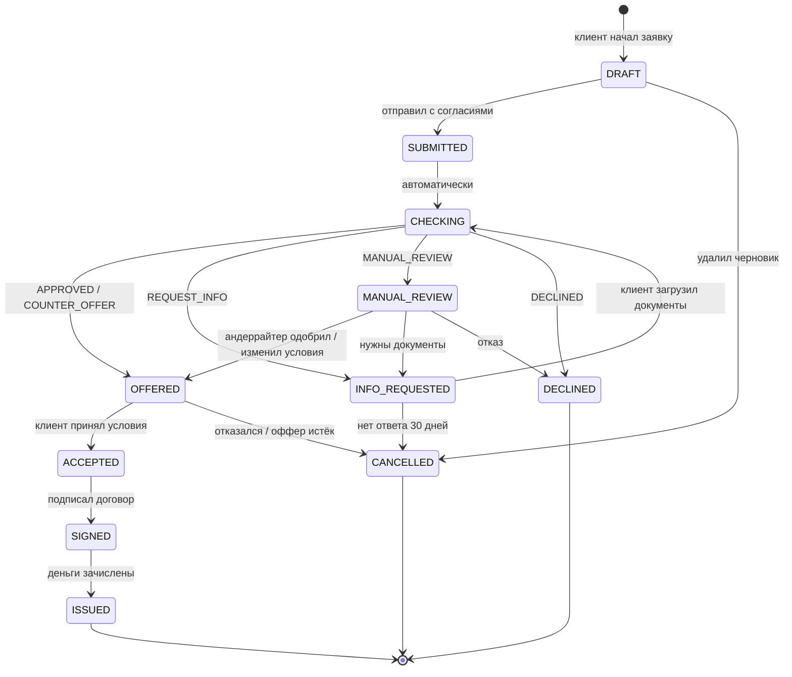
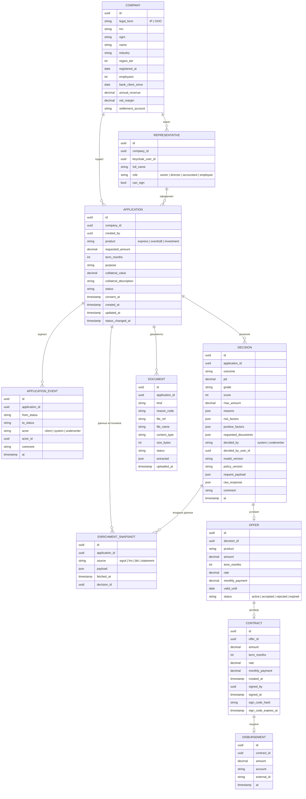

# Модель кредитного процесса

Документ описывает, что делает кредитный конвейер: где он начинается и заканчивается, из каких этапов
состоит, кто в нём участвует, какие данные нужны и чем может закончиться заявка. От этой модели
зависят статусы заявки в бэкенде, сущности в базе и API.

## 1. Границы процесса

**Старт:** у действующего клиента банка (ИП или ООО) появилась потребность в финансировании, и он
зашёл в кредитный кабинет.

**Финиш:** кредит выдан, деньги зачислены на расчётный счёт (зачисление моделируется), либо заявка
закрыта отказом или отменой.

**Входит в MVP:**

- подбор продукта и оформление заявки в кабинете;
- автоматическая проверка, обогащение данными, скоринг и кредитное решение;
- ручная проверка андеррайтером в нестандартных случаях;
- запрос дополнительных документов внутри той же заявки;
- встречное предложение, принятие оффера, подписание и выдача.

**Не входит в MVP (сознательно):**

| Что | Почему |
|---|---|
| Новые клиенты, регистрация юрлица, физлица без бизнеса | по условиям кейса работаем только с действующими клиентами |
| Посткредитное обслуживание (графики, досрочное погашение) | сценарий заканчивается выдачей (FAQ, п. 1) |
| Реальная оценка залога, выезд, юридическая экспертиза | заменяем заявленной стоимостью залога и ручной проверкой |
| Реальные БКИ, ФНС, ЕГРЮЛ, АБС, электронная подпись | заменяем моками с теми же смысловыми контрактами |
| Уведомления по SMS и почте | основной путь должен проходить внутри продукта |

## 2. Участники

| Участник | Кто это | Что делает |
|---|---|---|
| **Клиент** | представитель компании: собственник, директор, бухгалтер, уполномоченный сотрудник | выбирает продукт, заполняет заявку, отвечает на запросы, принимает оффер, подписывает |
| **Конвейер** | бэкенд-оркестратор | хранит заявку, двигает её по статусам, вызывает проверки и скоринг |
| **Источники данных** | моки: ЕГРЮЛ/ЕГРИП, ФНС, БКИ, выписка по счёту из АБС банка | отдают сведения о компании, налогах, кредитной истории и оборотах |
| **Скоринг-сервис** | `ml/`, `POST /v1/decision` | считает риск (PD, грейд) и выносит решение по кредитной политике |
| **Андеррайтер** | кредитный специалист банка | разбирает заявки со статусом ручной проверки и выносит решение |

Упрощение по полномочиям: заявку может готовить любой представитель компании, а подписывать
только руководитель (для ИП — сам предприниматель). Доверенности в MVP не моделируются.

## 3. Этапы

| № | Этап | Кто | Что происходит | Данные | Результат |
|---|---|---|---|---|---|
| 1 | Выбор продукта | клиент | указывает цель («пополнить оборотку», «купить оборудование»), видит подходящие продукты и примерный платёж | цель, ориентировочная сумма и срок | выбранный продукт |
| 2 | Заполнение заявки | клиент | данные о компании подставляются из профиля клиента банка, вводятся только параметры кредита и залог | сумма, срок, залог | черновик заявки (`DRAFT`) |
| 3 | Согласия и отправка | клиент | даёт согласие на запрос в БКИ и обработку данных (подпись моделируется кодом в интерфейсе) | факт и время согласия | `SUBMITTED` |
| 4 | Проверка полноты | конвейер | обязательные поля заполнены, сумма и срок в пределах продукта | заявка | ошибки сразу показываются клиенту |
| 5 | Обогащение | конвейер → моки | ЕГРЮЛ/ЕГРИП: статус и возраст бизнеса, ОКВЭД; ФНС: налоговая задолженность, массовый адрес, смены руководителя; БКИ: история и просрочки; АБС: обороты по счёту | снимок данных с источником и временем получения | заявка готова к скорингу |
| 6 | Скоринг и решение | скоринг-сервис | стоп-факторы → запрос данных → PD и грейд → лимит → триггеры ручной проверки → итог | заявка + снимок обогащения | один из 5 исходов (раздел 5) |
| 7 | Ручная проверка | андеррайтер | видит PD, факторы риска и причину передачи; одобряет, меняет условия, запрашивает документы или отказывает | решение системы + комментарий | итоговое решение |
| 8 | Дозапрос документов | клиент | загружает запрошенные документы в той же заявке; после загрузки заявка снова проходит проверку | документы | повторная проверка |
| 9 | Оффер | клиент | видит условия: сумму, срок, ставку, платёж и объяснение. Принимает или отказывается. Оффер действует 14 дней | оффер | `ACCEPTED` или `CANCELLED` |
| 10 | Подписание | клиент | подписывает договор (моделируется подтверждением кодом в интерфейсе) | договор, факт подписи | `SIGNED` |
| 11 | Выдача | конвейер → мок АБС | зачисление на расчётный счёт (моделируется) | операция выдачи | `ISSUED` |

### Взаимодействие участников

Основной сценарий по шагам: кто кому что передаёт. Ветки дозапроса документов и ручной проверки
показаны отдельными блоками.

### Правила, которые вытекают из исследования

Анализ отзывов ([research.md](research.md), раздел 4) показал, где процесс чаще всего ломается у
клиентов. Поэтому в модель процесса заложены правила:

| Правило | Какая боль | Доля жалоб |
|---|---|---|
| Клиент всегда видит статус заявки, ориентир по сроку и следующий шаг; каждое изменение статуса сразу показывается в кабинете | неизвестность после подачи | 61% |
| Данные, которые банк уже знает, не запрашиваются; вся история заявки в одной карточке, которую видят все участники | повторная передача данных и документов | 39% |
| Кредитное решение не зависит от подключения других продуктов банка | кредит в нагрузку к другим продуктам | 36% |
| Оффер содержит все условия, договор формируется из оффера без изменений | обещанные условия не совпали с фактическими | 32% |
| Решение всегда приходит с причинами простым языком | отказ без объяснения | 11% |

## 4. Статусы заявки

Что видит клиент:

| Статус | Текст в кабинете | Что делать клиенту |
|---|---|---|
| `DRAFT` | Черновик | заполнить и отправить |
| `SUBMITTED`, `CHECKING` | Заявка на рассмотрении | ничего, обычно это занимает минуты |
| `INFO_REQUESTED` | Нужны документы | загрузить документы из списка |
| `MANUAL_REVIEW` | Заявку проверяет специалист | ждать, ориентир — 1 рабочий день |
| `OFFERED` | Готово предложение | изучить условия и принять или отказаться |
| `ACCEPTED` | Условия приняты | подписать договор |
| `SIGNED` | Договор подписан | ждать зачисления |
| `ISSUED` | Деньги на счёте | — |
| `DECLINED` | Отказ | посмотреть причину; подать новую заявку на других условиях |
| `CANCELLED` | Заявка отменена | при необходимости подать новую |

Правила переходов:

- Дозапрос документов и встречное предложение происходят **внутри той же заявки**, чтобы не терялся
  контекст и не вводились данные повторно.
- После отказа подаётся **новая заявка**. Данные компании копируются, а старая заявка остаётся в
  истории с причиной отказа.
- Каждый переход пишется в журнал событий: кто, когда, из какого статуса в какой и почему.

## 5. Кредитное решение

Решение принимает скоринг-сервис (`ml/src/credit_scoring/decision.py`). Скоринговая оценка и решение
разделены: одна и та же оценка риска может дать разные исходы для разных продуктов и сумм.

| Исход скоринга | Когда | Статус заявки |
|---|---|---|
| `DECLINED` | стоп-факторы (просрочка 90+, бизнес меньше 3 месяцев, не МСБ), грейд E или обороты не тянут даже минимальную сумму | `DECLINED` |
| `REQUEST_INFO` | долг по налогам, через счёт идёт меньше 20% выручки, нет залога там, где он обязателен | `INFO_REQUESTED` |
| `MANUAL_REVIEW` | сумма больше 30 млн, массовый адрес, частая смена руководителя, грейд D с суммой больше 3 млн, нет кредитной истории при сумме больше 5 млн | `MANUAL_REVIEW` |
| `COUNTER_OFFER` | риск приемлемый, но запрошенная сумма больше лимита: предлагаем срок длиннее или сумму меньше | `OFFERED` |
| `APPROVED` | риск приемлемый, сумма в пределах лимита | `OFFERED` |

**Автоматика и человек.** Типовые заявки система решает сама: это быстро для клиента и дёшево для
банка. Человек подключается там, где цена ошибки высока или данных для модели недостаточно (триггеры
ручной проверки выше). Андеррайтер видит не только итог, но и PD, грейд, факторы риска и причину
передачи, поэтому ему не нужно собирать картину заново.

## 6. Модель данных

Поля, добавленные при реализации бэкенда:

| Сущность | Поля | Зачем |
|---|---|---|
| COMPANY | `annual_revenue`, `net_margin`, `settlement_account` | признаки скоринга «из профиля» и счёт для зачисления |
| REPRESENTATIVE | `keycloak_user_id` | связь пользователя SSO с представителем и компанией |
| APPLICATION | `collateral_description`, `status_changed_at` | описание залога для андеррайтера; срок в статусе и поиск зависших заявок |
| APPLICATION_EVENT | `actor_id` | «кто» — конкретный пользователь, а не только тип участника |
| ENRICHMENT_SNAPSHOT | `decision_id` | какие снимки ушли в какое решение |
| DECISION | `positive_factors`, `requested_documents`, `decided_by_user_id`, `request_payload`, `raw_response`, `comment` | запрос и ответ хранятся целиком, поэтому решение можно воспроизвести |
| DOCUMENT | `reason_code`, `file_name`, `content_type`, `size_bytes`, `status`, `extracted` | какой дозапрос закрывает документ и какие данные из него взяты |
| CONTRACT | `amount`, `term_months`, `rate`, `monthly_payment`, `created_at`, `sign_code_hash`, `sign_code_expires_at` | копия условий оффера для сверки при подписании; код подписи |
| DISBURSEMENT | `external_id` | номер операции в АБС: повтор не создаёт второго зачисления |

Ограничения в БД: одна активная заявка на компанию и продукт (частичный уникальный индекс);
`OFFER.decision_id`, `CONTRACT.offer_id` и `DISBURSEMENT.contract_id` уникальны.

Откуда берутся признаки скоринга:

| Поля запроса `/v1/decision` | Источник |
|---|---|
| `legal_form`, `industry`, `region_tier`, `employees` | профиль компании (`COMPANY`) |
| `business_age_months`, `director_changes_12m`, `mass_address` | мок ЕГРЮЛ/ЕГРИП |
| `tax_arrears` | мок ФНС |
| `bki_history_months`, `max_overdue_days_12m`, `overdue_count_24m`, `credit_inquiries_3m`, `existing_debt`, `monthly_debt_payments` | мок БКИ |
| `avg_monthly_turnover`, `turnover_volatility`, `turnover_trend_12m`, `cash_withdrawal_share`, `top_counterparty_share`, `bank_client_months` | выписка по счёту из АБС банка (мок) |
| `annual_revenue`, `net_margin` | отчётность компании (синтетика в профиле) |
| `product`, `requested_amount`, `term_months`, `collateral_value` | заявка |

Решения и снимки данных хранятся вместе с версиями модели и политики. Так любое решение можно
воспроизвести и объяснить задним числом, что важно для банка и для разбора жалоб.

## 7. Допущения

- Все данные синтетические, внешние источники заменены моками с упрощёнными контрактами.
- Подписание согласий и договора моделируется подтверждением кодом в интерфейсе, без SMS.
  В промышленной версии здесь были бы ПЭП/УКЭП через ДБО или Госключ.
- Выдача моделируется записью об операции, реальных проводок нет.
- Ключевая ставка задаётся настройкой (`KEY_RATE`), ставки по продуктам считаются от неё.
- Кредитный комитет для сумм больше 30 млн в MVP заменён той же ролью андеррайтера.
