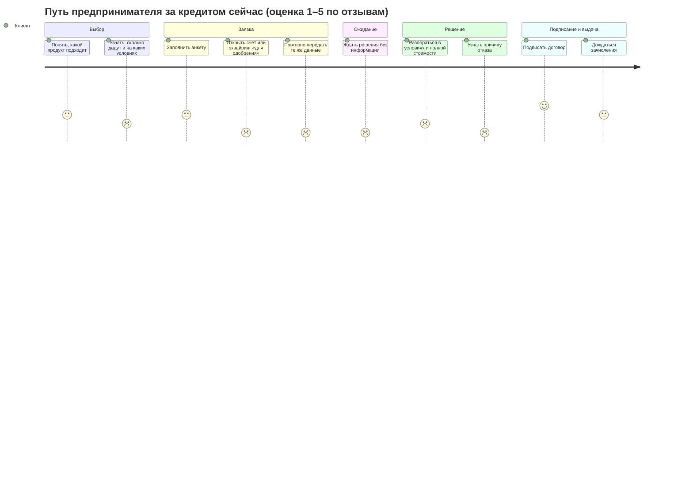

# Исследование: кто берёт кредит и что ему мешает

Цель — понять, какие задачи возникают у малого и микробизнеса при получении кредита, и на этой основе
выбрать, что войдёт в MVP.

Использовали два метода:

1. **Кабинетное исследование:** условия кейса, ответы организаторов, открытые описания кредитного процесса.
   Из него получили сегменты пользователей, задачи (JTBD) и первые гипотезы о болях.
2. **Анализ 200 отзывов предпринимателей** о кредитах для бизнеса на banki.ru (март–октябрь 2026).
   Им проверили гипотезы и нашли боли, которых сами не предполагали.

Интервью с предпринимателями не проводились. Это ограничение исследования, о нём в разделе 4.5.

## 1. Контекст

- В реестре МСП 6,6 млн компаний и ИП (июль 2026, +3,5% за год).
- Банки выдали МСП 1,313 трлн ₽ кредитов (июль 2026). Альфа-Банк выдал малому бизнесу больше 1 трлн ₽
  к октябрю 2025.
- Потребности разные: от небольшой суммы на короткий срок до крупного проекта с залогом.
- Для банка это поток заявок с разными продуктами и уровнем риска. Ручная обработка каждой заявки
  дорогая и медленная.

Источник цифр: условия кейса «Умный кредитный кабинет предпринимателя».

## 2. Пользователи

Кабинетом пользуется представитель действующего клиента банка. Сегменты выделены по тому, чем
отличается их путь, а не по формальной должности.

| Сегмент | Кто | Особенности | Что для него важно |
|---|---|---|---|
| **Микро-ИП** | предприниматель сам ведёт всё: продажи, закупки, деньги | нет финансиста; мало времени; кредит нужен быстро и на небольшую сумму | понять, дадут ли и сколько, без похода в банк и сбора бумаг |
| **Малое ООО, собственник** | директор и владелец, решения принимает сам | бывают крупные цели: оборудование, расширение; может быть залог | сравнить варианты, понять реальную ставку и платёж, сохранить контроль |
| **Малое ООО, бухгалтер / финдиректор** | готовит заявку по поручению руководителя | знает цифры, но не подписывает; передаёт документы | не вводить одно и то же; понятный список документов; видеть статус |

Общее для всех: нет банковской экспертизы, слова «PD», «ковенант», «DSCR» им ничего не говорят.
Об этом прямо говорится в кейсе.

Отзывы подтверждают, что кредитом занимается не только владелец. Есть отзывы от главного бухгалтера
([1](https://www.banki.ru/services/responses/bank/response/13044896/)),
от распорядителя по счёту ИП ([2](https://www.banki.ru/services/responses/bank/response/13109778/)),
от супруги, которая помогает мужу с бизнесом ([3](https://www.banki.ru/services/responses/bank/response/13170042/)),
а один написан с помощью бухгалтера ([4](https://www.banki.ru/services/responses/bank/response/13189280/)).

## 3. Задачи (JTBD)

| # | Когда… | я хочу… | чтобы… |
|---|---|---|---|
| J1 | у меня кассовый разрыв или нужна закупка к сезону | быстро получить оборотные деньги | не сорвать поставку и не потерять выручку |
| J2 | я планирую купить оборудование или расшириться | понять, какую сумму и на каком сроке я потяну | не взять кредит, который задушит бизнес |
| J3 | я выбираю, куда обращаться | заранее понять шансы и условия | не тратить время на заявку, которую отклонят |
| J4 | я отправил заявку | видеть, что с ней происходит и что от меня нужно | планировать деньги и не звонить в банк |
| J5 | мне отказали или предложили меньше | понять почему и что изменить | подать снова уже успешно |
| J6 | я готовлю заявку за руководителя | собрать данные один раз и передать на подпись | не дёргать директора по мелочам |

## 4. Анализ отзывов

### 4.1 Как собирали и размечали

- **Источник:** раздел «Кредитование бизнеса» народного рейтинга banki.ru, первые 8 страниц ленты,
  200 отзывов за 02.03.2026–20.10.2026. Один отзыв опубликован дважды, уникальных — 199.
- **Этап:** каждый отзыв отнесли к одному этапу:
  - **получение кредита** — выбор, заявка, рассмотрение, решение, подписание, выдача: **65 отзывов**;
  - **обслуживание** уже выданного — платежи, реструктуризация, штрафы, досрочное погашение: **112**;
  - **не про кредит** — счёт, эквайринг, общий сервис: **22**.
- **Что анализировали:** только 65 отзывов о получении кредита, потому что MVP заканчивается выдачей.
  Среди них 28 негативных (1–2★), 36 позитивных (4–5★) и 1 нейтральный.
- **Разметка:** в каждом отзыве отмечали все упомянутые проблемы или достоинства по кодам из таблицы
  ниже. Один отзыв может иметь несколько кодов.
- **Данные:** размеченная таблица со ссылкой на каждый отзыв — [research/banki_reviews_coded.csv](research/banki_reviews_coded.csv).
  Тексты отзывов не копировали, по ссылке можно открыть оригинал и перепроверить разметку.

| Код | Что значит |
|---|---|
| `STATUS` | долго нет решения, никто не связывается, непонятно, на каком этапе заявка |
| `UPSELL` | для рассмотрения кредита требуют открыть счёт, подключить эквайринг или другие услуги |
| `TERMS_MISMATCH` | обещали одни условия, по факту другие; скрытые условия (ставка только с платным пакетом) |
| `REENTRY` | одни и те же данные приходится передавать несколько раз |
| `DOCS_PIECEMEAL`, `DOCS_BURDEN`, `DOCS_CHANNEL` | документы запрашивают по частям, их сложно собрать или неудобно передать |
| `OFFICE` | нужно ехать в офис |
| `DECLINE_UNEXPLAINED` | отказ без объяснения причин |
| `DUP` | банк сам заводит дубли заявок |
| `CONSULT+` | сотрудник понятно объяснил условия, помог выбрать продукт |
| `SPEED+` | быстрое решение и выдача |
| `DOCS_HELP+`, `DATA_REUSE+` | помогли с документами; не просили лишнего, потому что данные у банка уже есть |
| `STATUS_VISIBLE+`, `NEXT_STEPS+` | клиента держали в курсе этапа и объяснили следующие шаги |
| `ELIGIBILITY_EXPLAINED+`, `ALT_PRODUCT+` | объяснили, почему продукт недоступен, и подобрали другой |

### 4.2 На что жалуются (28 негативных отзывов о получении кредита)

| Боль | Отзывов | Доля |
|---|---|---|
| **Неизвестность после подачи:** долго, никто не связывается, статус непонятен (`STATUS`) | 17 | **61%** |
| Документы, повторная передача данных, визиты в офис (все `DOCS_*`, `REENTRY`, `OFFICE`) | 11 | 39% |
| Кредит только при условии открыть счёт, подключить эквайринг или другую услугу (`UPSELL`) | 10 | 36% |
| Обещанные условия не совпали с фактическими, скрытые условия (`TERMS_MISMATCH`) | 9 | 32% |
| Отказ без объяснения причин (`DECLINE_UNEXPLAINED`) | 3 | 11% |
| Банк сам заводит дубли заявок (`DUP`) | 2 | 7% |

Типичные ситуации (ссылки ведут на отзывы):

- Заявку оформили, решение пришло через три недели, клиента о нём не известили, а в кабинете ещё неделю
  висел статус «на рассмотрении» ([отзыв](https://www.banki.ru/services/responses/bank/response/13299186/)).
- За три недели клиенту позвонили пять разных менеджеров, и каждый заново просил документы
  ([отзыв](https://www.banki.ru/services/responses/bank/response/13170048/)).
- Клиент отправил заявки в пять банков. Четыре дали условия за 1–2 дня, а в пятом его трижды заново
  спрашивали сумму и срок ([отзыв](https://www.banki.ru/services/responses/bank/response/13086271/)).
- Невыгодные условия всплыли после выдачи: низкая ставка действовала только с платным пакетом услуг
  ([отзыв](https://www.banki.ru/services/responses/bank/response/12971277/)).
- В одном из отзывов предприниматель пишет, что «никто не может дать ответ на какой стадии моя заявка»
  ([отзыв](https://www.banki.ru/services/responses/bank/response/12985751/)).

### 4.3 За что хвалят (36 позитивных отзывов о получении кредита)

| Что ценят | Отзывов | Доля |
|---|---|---|
| Понятно объяснили условия, помогли выбрать (`CONSULT+`) | 20 | **56%** |
| Быстро рассмотрели и выдали (`SPEED+`) | 17 | **47%** |
| Помогли с документами или не просили лишнего (`DOCS_HELP+`, `DATA_REUSE+`) | 8 | 22% |
| Держали в курсе этапа, объяснили, что дальше (`STATUS_VISIBLE+`, `NEXT_STEPS+`) | 4 | 11% |
| Объяснили, почему продукт недоступен, и подобрали другой (`ELIGIBILITY_EXPLAINED+`, `ALT_PRODUCT+`) | 2 | 6% |

Позитивные отзывы — зеркало негативных: клиенты ценят понятные объяснения, скорость и то, что их
держат в курсе. Сейчас всё это зависит от того, повезло ли с конкретным менеджером. Наша задача —
встроить это в продукт, чтобы не зависеть от везения.

### 4.4 Что изменилось в наших выводах

1. **Главная боль — неизвестность, а не документы.** Мы ставили на первое место повторный ввод данных
   (гипотеза H2). По отзывам он на втором месте, а на первом — тишина после подачи. Поэтому прозрачный
   статус с ориентиром по срокам и следующим шагом — обязательная часть MVP, а не «приятное дополнение».
2. **Новая боль: кредит в нагрузку к другим продуктам.** Мы её не предполагали. В нашем решении кредит
   получает действующий клиент банка, поэтому кредитное решение не зависит от покупки других услуг
   (раздел 5, Б9).
3. **Новая боль: расхождение условий.** Обещали одно, в договоре другое. Значит, оффер должен показывать
   полную стоимость и все условия сразу, а договор должен формироваться из оффера без изменений (Б8).
4. **Объяснения — главный драйвер позитива (56%).** Это подтверждает решение показывать причины
   решения и факторы риска простым языком.

### 4.5 Ограничения

- **Смещение к недовольным:** отзывы чаще пишут после плохого опыта. Доли показывают, на что жалуются
  те, кто жалуется, а не как часто проблема встречается у всех клиентов.
- **Неравномерность по банкам:** 20 из 65 отзывов о получении кредита — про Альфа-Банк, 19 — про
  Россельхозбанк. Выводы о конкретных банках мы не делаем, смотрим только на типы проблем.
- **Малая выборка:** 65 отзывов. Цифры показывают порядок величины, а не точную статистику.
- **Один разметчик:** коды проставлял один человек. Чтобы любую разметку можно было перепроверить,
  CSV ссылается на каждый отзыв.
- **Нет интервью:** мы не слышали тех, кто не пишет отзывы. Сценарий интервью — в разделе 9.

## 5. Боли и что с ними делаем

Каждая функция MVP должна закрывать конкретную боль. Колонка «В отзывах» — сколько из 28 негативных
отзывов о получении кредита содержат эту боль.

| Боль | В отзывах | Что делаем в продукте | Где в решении |
|---|---|---|---|
| **Б3. «Чёрный ящик» после отправки** | 17 (61%) | статус всегда виден в кабинете, у каждого статуса — ориентир по срокам и «что делать сейчас»; каждое изменение статуса показывается клиенту | раздел 4 [process.md](process.md), журнал событий |
| **Б6. Долго ждать решения** | входит в Б3 | типовые заявки решаются автоматически за секунды; человек подключается только в сложных случаях | скоринг + триггеры `MANUAL_REVIEW` |
| **Б2. Повторный ввод данных** | 11 (39%) вместе с Б7 | данные компании и оборотов берутся из профиля клиента и источников; клиент вводит только сумму, срок и залог; одна заявка — одна карточка, которую видят все участники | этапы 2 и 5 процесса |
| **Б7. Документы по кругу** | см. Б2 | полный список документов сразу и загрузка в ту же заявку, без почты и офиса | исход `REQUEST_INFO`, статус `INFO_REQUESTED` |
| **Б9. Кредит в нагрузку к другим продуктам** (новая) | 10 (36%) | работаем с действующими клиентами, счёт уже есть; кредитное решение не зависит от подключения других услуг | кредитная политика `decision.py` |
| **Б8. Условия не те, что обещали; скрытые условия** (расширена) | 9 (32%) | в оффере сразу сумма, срок, ставка, платёж и все обязательные условия; договор формируется из оффера без изменений | `offer` в ответе решения; сущность `OFFER` → `CONTRACT` |
| **Б4. Отказ без объяснения** | 3 (11%) | причины решения и главные факторы риска простым языком | `reasons`, `risk_factors` в `/v1/decision` |
| **Б5. Всё или ничего** | — | встречное предложение: сначала дольше срок, потом меньше сумма | исход `COUNTER_OFFER` |
| **Б1. Непонятно, какой продукт выбрать** | 1 | выбор по цели («оборотка», «оборудование», «запас на счёте») → продукт и примерный платёж | этап 1 процесса; `GET /v1/products` |

Б1 и Б5 в жалобах почти не встречаются, но объяснения условий и подбор продукта — самая частая причина
позитивных отзывов (56%). Поэтому оставляем их в MVP.

Боли банка, которые тоже учитываем (FAQ: важны обе стороны):

| Боль банка | Что делаем |
|---|---|
| Дорого обрабатывать каждую заявку вручную | автоматическое решение для типовых заявок |
| Неполные заявки возвращаются по кругу | проверка полноты до скоринга, дозапрос внутри заявки |
| Заявку передают между сотрудниками, контекст теряется (видно по отзывам) | одна карточка заявки с журналом событий, андеррайтер видит всё сразу |
| Нужно объяснять решения регулятору и клиенту | хранение решений с версией модели и политики, факторы риска |
| Риск выдать слишком много | лимит по платёжеспособности, стоп-факторы, ручная проверка крупных сумм |

## 6. Карта пути клиента (CJM)

Как выглядит путь за кредитом сейчас, судя по отзывам, и что меняет наш кабинет.

Оценки качественные, по тону отзывов о каждом этапе.

| Этап | Что делает клиент | Что чувствует (по отзывам) | Боль | Как в нашем кабинете |
|---|---|---|---|---|
| Выбор | ищет подходящий продукт, сравнивает банки | хочет быстро понять шансы и условия, часто подаёт в несколько банков сразу | Б1 | выбор по цели, примерный платёж до подачи |
| Заявка | заполняет анкету, отправляет документы | раздражение, если просят то, что банк и так знает, или требуют открыть счёт | Б2, Б9 | данные подтягиваются из профиля, вводятся только параметры кредита; никаких условий «сначала откройте счёт» |
| Ожидание | ждёт решения | тревога и злость: «никто не может сказать, на какой стадии» | Б3, Б6 | статус и ориентир по сроку всегда видны; автоматическое решение за минуты |
| Дозапрос | досылает документы | усталость, когда просят по частям и разные люди | Б7 | один полный список, загрузка в ту же заявку |
| Решение | изучает условия или причину отказа | недоверие, если условия меняются; обида при отказе без причины | Б4, Б5, Б8 | оффер с полными условиями; причины решения; встречное предложение вместо отказа |
| Подписание и выдача | подписывает, ждёт денег | обычно доволен; раздражается, если деньги не пришли в обещанный срок | Б3 | статусы `SIGNED` → `ISSUED`, выдача сразу после подписания |

## 7. Приоритизация (MoSCoW)

| Must | Should | Could | Won't (в MVP) |
|---|---|---|---|
| выбор продукта, заявка с автозаполнением, **прозрачные статусы с ориентиром по срокам**, скоринг и решение, оффер с полными условиями, подписание и выдача (моделируемые), обработка андеррайтером | объяснение причин решения, встречное предложение, дозапрос документов | калькулятор «что если» до подачи, LLM-помощник | посткредит, новые клиенты, реальные интеграции, мобильное приложение |

Почему так:

- **Must** — сквозной путь из кейса, без него решение не принимается. Прозрачные статусы подняты в Must,
  потому что это боль №1 по отзывам (61%).
- **Should** — то, что отличает «умный» кабинет от формы заявки. Закрывает Б4, Б5, Б7 и опирается
  на главный драйвер позитива — понятные объяснения.
- **Could / Won't:** LLM отложен, потому что за сам факт ИИ баллов не дают, а объяснения решения уже
  есть без него. Обслуживание выданных кредитов — самая частая тема отзывов (112 из 199), но по
  условиям кейса сценарий заканчивается выдачей. Это направление для развития.

## 8. Гипотезы

| # | Гипотеза | Результат | Основание |
|---|---|---|---|
| H1 | Предпринимателю важнее заранее понять сумму и платёж, чем ставку | **Уточнена** | Клиенты хотят заранее знать доступную сумму и сравнивают предложения банков. Но 32% жалоб — про ставку и скрытые условия, так что важна полная стоимость, а не только сумма |
| H2 | Самое раздражающее — сбор документов и повторный ввод данных | **Частично подтверждена** | 39% негативных отзывов, но это второе место. Первое — неизвестность после подачи (61%) |
| H3 | При отказе клиент хочет знать причину и что изменить | **Слабо подтверждена** | Встречается в 11% жалоб: отказы реже становятся поводом для отзыва, чем ожидание |
| H4 | Меньшая сумма или более долгий срок лучше отказа | **Недостаточно данных** | Один позитивный отзыв: вместо недоступного продукта подобрали другой |
| H5 | В ООО заявку часто готовит не тот, кто подписывает | **Подтверждена косвенно** | 4 отзыва написаны бухгалтером, распорядителем или помощником владельца |
| H6 | Главная боль — неизвестность после подачи заявки (появилась по ходу анализа) | **Подтверждена** | 17 из 28 негативных отзывов о получении кредита |

## 9. Что можно сделать дальше

Если появится возможность поговорить с предпринимателями, это закроет главное ограничение
исследования. Достаточно 3–5 человек, 15–20 минут. Особенно нужно проверить H3 и H4, по ним в отзывах
мало данных.

1. Чем занимается бизнес, сколько человек, давно ли работаете?
2. Кто у вас занимается кредитами и банком? Кто подписывает?
3. Вспомните последний раз, когда вам нужны были заёмные деньги. Для чего?
4. Как вы выбирали, где и какой кредит брать? Что смотрели в первую очередь?
5. Понимали ли вы заранее, сколько вам одобрят и какой будет платёж?
6. Что было самым неудобным в оформлении? Сколько времени ушло?
7. Как вы узнавали, что происходит с заявкой?
8. Было ли так, что отказали или одобрили меньше? Объяснили ли почему?
9. Если бы вместо отказа предложили меньшую сумму или более долгий срок — согласились бы?
10. Если бы можно было поменять одну вещь в процессе получения кредита, что бы это было?
